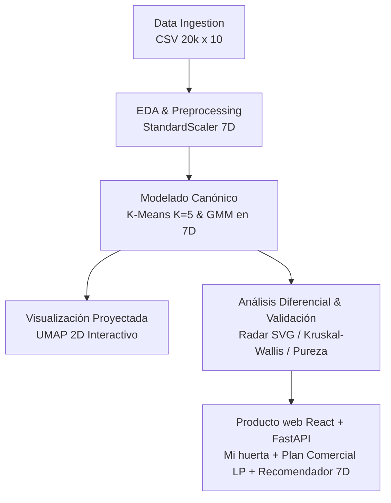

# Project Terra


> Benchmark metodológico de clustering ambiental y planificador agrícola determinístico (hogar y comercial).

**Project Terra** evalúa de forma reproducible si es posible descubrir "ecorregiones funcionales" agrícolas a partir de variables de suelo y clima (N, P, K, pH, temperatura, humedad y precipitación). El módulo de clustering no supervisado (K-Means 7D, GMM, Clustering Jerárquico y proyección UMAP 2D) funciona como un **benchmark exploratorio** —donde la hipótesis de separabilidad agronómica natural fue refutada empíricamente sobre el dataset sintético actual— acoplado a un **planificador agrícola determinístico** (`Mi huerta` para hogares y Programación Lineal `HiGHS` para parcelas comerciales).

Proyecto del curso **Analítica y Minería de Datos** — Escuela de Transformación Digital, Universidad Tecnológica de Bolívar (UTB).

## Equipo

- Dariem Antonio García Cardona
- Jasen Mihovil Yukopila Escobar
- Carlos Miguel Toro Torres

## Objetivos

**Objetivo general:** implementar un modelo de clustering sobre un dataset de recomendación de cultivos para segmentar los registros en grupos homogéneos según sus condiciones climáticas y edáficas.

**Objetivos específicos:**
- Realizar un EDA exhaustivo (distribuciones, atípicos, correlaciones multivariantes, relaciones no lineales).
- Preprocesar y estandarizar variables (`StandardScaler` en producción y análisis).
- Evaluar PCA y UMAP para verificar si existe estructura lineal o no lineal y habilitar la exploración 2D interactiva.
- Segmentar con K-Means 7D, GMM y Clustering Jerárquico Aglomerativo, adoptando $K=5$ como elección operativa de interpretabilidad.
- Caracterizar cada clúster mediante estadísticos descriptivos y gráficos de radar SVG tanto en notebooks como en la interfaz web.
- Distinguir validación externa contra `Crop` (Pureza, ARI, NMI, pruebas de permutación) del diagnóstico geométrico post-hoc entre variables de entrada (Kruskal-Wallis).

## Dataset

Dataset sintético tipo *Crop Recommendation* (`20,000 × 10`) con 7 variables ambientales predictoras más etiquetas categóricas de referencia (`Crop`, `Soil_Type`, `Variety`):

| Variable | Descripción | Unidad / Escala |
| :--- | :--- | :--- |
| **Nitrogen** | Contenido de Nitrógeno en el suelo | mg/kg (ppm) |
| **Phosphorus** | Contenido de Fósforo en el suelo | mg/kg (ppm) |
| **Potassium** | Contenido de Potasio en el suelo | mg/kg (ppm) |
| **Temperature** | Temperatura ambiente | °C |
| **Humidity** | Humedad relativa | % |
| **pH_Value** | Valor de pH del suelo | 0–14 |
| **Rainfall** | Precipitación (escala sintética del dataset) | mm (20–400) |
| **Crop** | Cultivo de referencia (validación externa) | Categórica (6 clases) |
| **Soil_Type** | Tipo de suelo | Categórica |
| **Variety** | Variedad de cultivo *(no usar en clustering: fuga determinista 3:1 hacia `Crop`)* | Categórica |

Fuente: [Crops NPK Data Set — Kaggle](https://www.kaggle.com/datasets/javakhan/crops-npk-data-set)

> **Nota de versionamiento:** `data/processed/sensor_Crop_Dataset_clustered.csv` y los modelos en `data/models/` **sí están versionados en Git**, por lo que la aplicación web y la API funcionan sin descargar Kaggle. El CSV crudo (`data/raw/sensor_Crop_Dataset.csv`, gitignored) solo es necesario si deseas re-ejecutar `src/run_pipeline.py` desde cero.

## Estructura del repositorio

```text
Project_Terra/
├── .github/workflows/  # Pipeline CI (pytest, ruff, build/tests frontend)
├── api/                # API FastAPI (análisis, recomendación 7D, motor LP HiGHS)
├── data/
│   ├── economics/      # Catálogo económico colombiano editable (DANE/UPRA/FAO)
│   ├── models/         # Modelos canónicos 7D (kmeans_k5, scaler, gmm_k5_full)
│   ├── processed/      # Dataset enriquecido con clústeres 7D y coords UMAP 2D
│   └── raw/            # Dataset original gitignored (solo para re-entrenamiento)
├── docs/               # Changelog, Roadmap, Design Review y propuesta de manuscrito
├── frontend/           # SPA React 18 + Vite 6 + Vitest/node:test + PDF/CSV
├── notebooks/          # 01 EDA, 02 PCA, 03 Clustering, 03_b UMAP/t-SNE, 04 Profiling, 05 Dashboard
├── scripts/            # Utilidades de proyección UMAP 2D y figuras
├── src/                # Módulos reproducibles (clustering.py, profiling.py, run_pipeline.py)
├── tests/              # Suite de pruebas Python (pytest)
├── Dockerfile          # Build multi-etapa Node + Python Uvicorn
├── vercel.json         # Despliegue serverless
├── requirements.txt
└── README.md
```

## Documentación y Seguimiento

Para llevar un control detallado del avance y decisiones técnicas, consulta [`docs/`](docs/):

- [**Índice de Documentación**](docs/README.md): Guía general de documentación técnica.
- [**Changelog**](docs/CHANGELOG.md): Registro histórico de fases completadas y características implementadas.
- [**Roadmap**](docs/ROADMAP.md): Lista de tareas pendientes y próximos pasos planificados.
- [**Revisión de Diseño**](docs/design-review/README.md): Hallazgos y ajustes de interfaz.

## Cómo empezar

```bash
git clone https://github.com/DaryelReyes/Project_Terra.git
cd Project_Terra
python -m venv venv
source venv/bin/activate  # Windows: venv\Scripts\activate
pip install -r requirements-dev.txt
```

### Ejecutar el producto web y pruebas

```bash
# Compilar frontend y servir todo con FastAPI/Uvicorn
cd frontend && npm ci && npm run build
cd .. && python -m uvicorn api.server:app --host 0.0.0.0 --port 5000

# En desarrollo (frontend con hot-reload en :5173 conectado al backend en :5000)
# cd frontend && npm run dev

# Ejecutar pruebas
python -m pytest -v
cd frontend && node --test tests/*.test.js
```

## Metodología (fases)



- [x] 1. **Ingeniería de datos y EDA avanzado** — limpieza, correlaciones, pairplots, PCA preliminar. *(Completado, [`01_eda_crops_npk.ipynb`](notebooks/01_eda_crops_npk.ipynb))*
- [x] 2. **Determinación del número de clústeres (K)** — codo (inercia), silueta (`0.0986`) y Davies-Bouldin (`2.1490`). *(Completado, [`03_clustering_model.ipynb`](notebooks/03_clustering_model.ipynb): ninguna métrica marca un K claramente óptimo; se fijó K=5 por interpretabilidad operativa)*
- [x] 3. **Ejecución del clustering multivariado** — K-Means (K=5), GMM y Jerárquico sobre los 7 features escalados (`StandardScaler`); UMAP 2D reservado exclusivamente para proyección visual. *(Completado, [`src/run_pipeline.py`](src/run_pipeline.py) + [`scripts/export_umap.py`](scripts/export_umap.py))*
- [x] 4. **Análisis diferencial y validación** — firma ambiental (radar SVG/Plotly), análisis de `Soil_Type`, pureza (`17.50%`) y diagnóstico geométrico Kruskal-Wallis (`H > 8,000` en Humedad, pH, Precipitación y Potasio sobre la partición 7D). *(Completado, [`04_cluster_profiling.ipynb`](notebooks/04_cluster_profiling.ipynb))*
- [x] 5. **Producto web dual (`Mi huerta` + Recomendador)** — interfaz React responsive conectada a FastAPI, incluyendo **`Mi huerta`** (`/producto/plan/huerta`, asistente doméstico de 5 preguntas con PDF de 2 páginas sin dependencias), explorador UMAP 2D, perfiles radiales SVG, probabilidades GMM y detección de perfiles fuera de rango típico (`||z||_2 > 3.6744`).
- [x] 6. **Planeación económica de la parcela (`/producto/plan/comercial`)** — optimizador LP (`HiGHS`) en dos etapas con restricciones de área, presupuesto y agua; escenarios conservador, esperado y favorable; comparación manual, exportación PDF/CSV y referencias editables de DANE SIPSA, UPRA/EVA y FAO CROPWAT.

> **Hallazgo clave**: con las variables disponibles del dataset sintético uniforme, no existe una estructura de clústeres fuerte ni agronómicamente coherente para ningún K probado (`|r| < 0.05`, pureza `17.50%`). Se advierte expresamente **no usar `Variety`** como predictor por fuga determinista 3:1 hacia `Crop`.

## Metodología económica

El **Plan rentable** usa programación lineal en dos etapas (`HiGHS`) para maximizar la utilidad neta esperada (`precio × rendimiento × área − costo × área`) respetando área, presupuesto, agua disponible y límites por cultivo. En la Etapa 2, el parámetro `suitability_tiebreak_weight` (`0–1`) permite ceder hasta un **20 % × peso** de la ganancia máxima (si `peso = 0`, el desempate es estrictamente lexicográfico $\epsilon = 0$) para priorizar cultivos con mayor afinidad edafoclimática; nunca altera precios, costos ni rendimientos.

El catálogo incluido es una referencia versionada y disponible sin conexión. Todos sus valores son visibles y editables. DANE SIPSA aporta contexto de precios mayoristas (base Bogotá), UPRA/EVA aporta contexto de producción y rendimiento, las fichas UPRA aportan contexto de costos, y FAO-56/CROPWAT aporta la metodología hídrica. Las cifras no son cotizaciones en tiempo real ni garantías de utilidad.

## Trabajo Futuro: Datos Reales y Contrastive Learning

La limitación actual no radica en el algoritmo de clustering sino en la ausencia de señal agronómica del dataset sintético uniforme ($I(X;Y) \approx 0$). Por ello, la hoja de ruta técnica se ordena en dos hitos secuenciales:
1. **Fase previa obligatoria — Ingesta de datos agroclimáticos reales georreferenciados:** integrar series reales (SoilGrids, IDEAM/WorldClim, EVA/AGROSAVIA) con covarianzas naturales entre clima, suelo y rendimiento.
2. **Contrastive Learning tabular (condicionado a datos reales):** una vez disponibles datos reales, evaluar un *Encoder* MLP con pérdida InfoNCE y augmentations tabulares (p. ej. corrupción aleatoria tipo SCARF) frente a K-Means 7D y GMM.

## Entregables esperados

- Dataset enriquecido con la variable de clúster asignada.
- Informe técnico del EDA, algoritmo elegido e interpretación de perfiles.
- Dashboards/gráficos de radar comparando perfiles ambientales.
- Conclusiones prácticas y estratégicas para asignación de recursos agrícolas.

## Licencia

Este proyecto está bajo la licencia MIT — ver [LICENSE](LICENSE) para más detalles.
