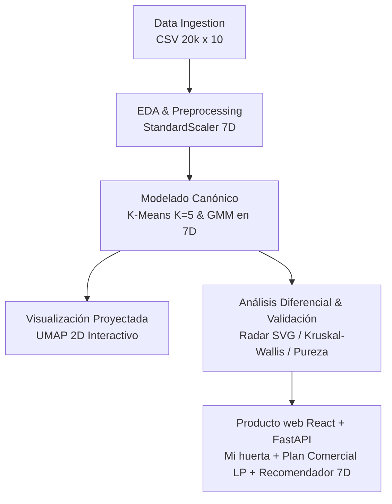

# Project Terra


> Clustering ambiental sobre datos agroclimáticos reales de Colombia (AGROSAVIA + UPRA EVA + DANE DIVIPOLA + NASA POWER) y planificador agrícola determinístico (hogar y comercial).

**Project Terra** segmenta condiciones agroclimáticas reales de Colombia (N/MO, P, K, pH, temperatura, humedad y precipitación) en **5 ecorregiones funcionales** mediante clustering no supervisado 7D (`StandardScaler` + K-Means $K=5$ + GMM + proyección UMAP 2D), tras un benchmark reproducible que refutó la separabilidad del dataset sintético original y demostró un salto masivo de señal al integrar datos reales georreferenciados (ver [`docs/real_data_benchmark.json`](docs/real_data_benchmark.json)). El modelo se acopla a un **planificador agrícola determinístico** (`Mi huerta` para hogares y Programación Lineal `HiGHS` para parcelas comerciales).

Proyecto del curso **Analítica y Minería de Datos** — Escuela de Transformación Digital, Universidad Tecnológica de Bolívar (UTB).

## Equipo

- Dariem Antonio García Cardona
- Jasen Mihovil Yukopila Escobar
- Carlos Miguel Toro Torres

## Objetivos

**Objetivo general:** implementar un modelo de clustering sobre un dataset de recomendación de cultivos para segmentar los registros en grupos homogéneos según sus condiciones climáticas y edáficas.

**Objetivos específicos:**
- Realizar un EDA exhaustivo (distribuciones, atípicos, correlaciones multivariantes, relaciones no lineales).
- Preprocesar y estandarizar variables (`StandardScaler` en producción y análisis).
- Evaluar PCA y UMAP para verificar si existe estructura lineal o no lineal y habilitar la exploración 2D interactiva.
- Segmentar con K-Means 7D, GMM y Clustering Jerárquico Aglomerativo, adoptando $K=5$ como elección operativa de interpretabilidad.
- Caracterizar cada clúster mediante estadísticos descriptivos y gráficos de radar SVG tanto en notebooks como en la interfaz web.
- Distinguir validación externa contra `Crop` (Pureza, ARI, NMI, pruebas de permutación) del diagnóstico geométrico post-hoc entre variables de entrada (Kruskal-Wallis).

## Dataset

### Dataset en producción (Fase 8 — Datos Reales de Colombia)
Dataset agroclimático real georreferenciado (**12,784 registros × 678 municipios de Colombia**), generado de forma reproducible con [`scripts/ingest_real_colombia.py`](scripts/ingest_real_colombia.py) y promovido con [`scripts/promote_real_model.py`](scripts/promote_real_model.py):

- **Suelos de laboratorio reales:** **AGROSAVIA** — *Resultados de Análisis de Laboratorio Suelos en Colombia* (`datos.gov.co/ch4u-f3i5`: pH, Fósforo Bray II, Potasio intercambiable convertido a mg/kg, Materia Orgánica como proxy de N disponible, CICE, CE y drenaje).
- **Enriquecimiento de trigo:** municipios trigueros verificados en **UPRA EVA 2019–2025** (`datos.gov.co/uejq-wxrr`).
- **Georreferenciación:** **DANE DIVIPOLA** (`datos.gov.co/gdxc-w37w`, 99.8 % de emparejamiento municipal).
- **Clima real:** **NASA POWER Climatology API** (`community=AG`: `T2M` °C, `RH2M` %, `PRECTOTCORR` mm/mes).

Conserva exactamente las **7 variables predictoras** (`Nitrogen`, `Phosphorus`, `Potassium`, `Temperature`, `Humidity`, `pH_Value`, `Rainfall`), los **6 cultivos** (`Sugarcane`, `Rice`, `Maize`, `Potato`, `Tomato`, `Wheat`) y los **6 tipos de suelo** (`Loamy`, `Clay`, `Sandy`, `Silt`, `Peaty`, `Saline`).

> **Nota de versionamiento:** `data/processed/sensor_Crop_Dataset_clustered.csv`, `data/models/model_metadata.json` y los modelos `.joblib` en `data/models/` están versionados en Git, por lo que la aplicación web y la API funcionan sin descargas externas. Para regenerar el dataset intermedio (`data/processed/colombia_agroclimatic_real.csv`, gitignored) desde las APIs abiertas, ejecuta `scripts/ingest_real_colombia.py`. El dataset sintético original de Kaggle (`20,000 × 10`, [`Crops NPK Data Set`](https://www.kaggle.com/datasets/javakhan/crops-npk-data-set)) se documenta únicamente como baseline histórico en [`docs/real_data_benchmark.json`](docs/real_data_benchmark.json) (y nunca usa `Variety` por fuga determinista 3:1 hacia `Crop`).

## Estructura del repositorio

```text
Project_Terra/
├── .github/workflows/  # Pipeline CI (pytest, ruff, build/tests frontend)
├── api/                # API FastAPI (análisis, recomendación 7D, motor LP HiGHS)
├── data/
│   ├── economics/      # Catálogo económico colombiano editable (DANE/UPRA/FAO)
│   ├── models/         # Modelos canónicos 7D (kmeans_k5, scaler, gmm_k5_full)
│   ├── processed/      # Dataset enriquecido con clústeres 7D y coords UMAP 2D
│   └── raw/            # Dataset original gitignored (solo para re-entrenamiento)
├── docs/               # Changelog, Roadmap, Design Review y propuesta de manuscrito
├── frontend/           # SPA React 18 + Vite 6 + Vitest/node:test + PDF/CSV
├── notebooks/          # 01 EDA, 02 PCA, 03 Clustering, 03_b UMAP/t-SNE, 04 Profiling, 05 Dashboard
├── scripts/            # Utilidades de proyección UMAP 2D y figuras
├── src/                # Módulos reproducibles (clustering.py, profiling.py, run_pipeline.py)
├── tests/              # Suite de pruebas Python (pytest)
├── Dockerfile          # Build multi-etapa Node + Python Uvicorn
├── vercel.json         # Despliegue serverless
├── requirements.txt
└── README.md
```

## Documentación y Seguimiento

Para llevar un control detallado del avance y decisiones técnicas, consulta [`docs/`](docs/):

- [**Índice de Documentación**](docs/README.md): Guía general de documentación técnica.
- [**Changelog**](docs/CHANGELOG.md): Registro histórico de fases completadas y características implementadas.
- [**Roadmap**](docs/ROADMAP.md): Lista de tareas pendientes y próximos pasos planificados.
- [**Revisión de Diseño**](docs/design-review/README.md): Hallazgos y ajustes de interfaz.

## Cómo empezar

```bash
git clone https://github.com/DaryelReyes/Project_Terra.git
cd Project_Terra
python -m venv venv
source venv/bin/activate  # Windows: venv\Scripts\activate
pip install -r requirements-dev.txt
```

### Ejecutar el producto web y pruebas

```bash
# Compilar frontend y servir todo con FastAPI/Uvicorn
cd frontend && npm ci && npm run build
cd .. && python -m uvicorn api.server:app --host 0.0.0.0 --port 5000

# En desarrollo (frontend con hot-reload en :5173 conectado al backend en :5000)
# cd frontend && npm run dev

# Ejecutar pruebas
python -m pytest -v
cd frontend && node --test tests/*.test.js
```

## Metodología (fases)



- [x] 1. **Ingeniería de datos y EDA avanzado** — limpieza, correlaciones, pairplots, PCA preliminar. *(Completado, [`01_eda_crops_npk.ipynb`](notebooks/01_eda_crops_npk.ipynb))*
- [x] 2. **Determinación del número de clústeres (K)** — codo (inercia), silueta (`0.0986`) y Davies-Bouldin (`2.1490`). *(Completado, [`03_clustering_model.ipynb`](notebooks/03_clustering_model.ipynb): ninguna métrica marca un K claramente óptimo; se fijó K=5 por interpretabilidad operativa)*
- [x] 3. **Ejecución del clustering multivariado** — K-Means (K=5), GMM y Jerárquico sobre los 7 features escalados (`StandardScaler`); UMAP 2D reservado exclusivamente para proyección visual. *(Completado, [`src/run_pipeline.py`](src/run_pipeline.py) + [`scripts/export_umap.py`](scripts/export_umap.py))*
- [x] 4. **Análisis diferencial y validación** — firma ambiental (radar SVG/Plotly), análisis de `Soil_Type`, pureza (`17.50%`) y diagnóstico geométrico Kruskal-Wallis (`H > 8,000` en Humedad, pH, Precipitación y Potasio sobre la partición 7D). *(Completado, [`04_cluster_profiling.ipynb`](notebooks/04_cluster_profiling.ipynb))*
- [x] 5. **Producto web dual (`Mi huerta` + Recomendador)** — interfaz React responsive conectada a FastAPI, incluyendo **`Mi huerta`** (`/producto/plan/huerta`, asistente doméstico de 5 preguntas con PDF de 2 páginas sin dependencias), explorador UMAP 2D, perfiles radiales SVG, probabilidades GMM y detección de perfiles fuera de rango típico (`||z||_2 > 3.6744`).
- [x] 6. **Planeación económica de la parcela (`/producto/plan/comercial`)** — optimizador LP (`HiGHS`) en dos etapas con restricciones de área, presupuesto y agua; escenarios conservador, esperado y favorable; comparación manual, exportación PDF/CSV y referencias editables de DANE SIPSA, UPRA/EVA y FAO CROPWAT.

> **Hallazgo clave**: con las variables disponibles del dataset sintético uniforme, no existe una estructura de clústeres fuerte ni agronómicamente coherente para ningún K probado (`|r| < 0.05`, pureza `17.50%`). Se advierte expresamente **no usar `Variety`** como predictor por fuga determinista 3:1 hacia `Crop`.

## Metodología económica

El **Plan rentable** usa programación lineal en dos etapas (`HiGHS`) para maximizar la utilidad neta esperada (`precio × rendimiento × área − costo × área`) respetando área, presupuesto, agua disponible y límites por cultivo. En la Etapa 2, el parámetro `suitability_tiebreak_weight` (`0–1`) permite ceder hasta un **20 % × peso** de la ganancia máxima (si `peso = 0`, el desempate es estrictamente lexicográfico $\epsilon = 0$) para priorizar cultivos con mayor afinidad edafoclimática; nunca altera precios, costos ni rendimientos.

El catálogo incluido es una referencia versionada y disponible sin conexión. Todos sus valores son visibles y editables. DANE SIPSA aporta contexto de precios mayoristas (base Bogotá), UPRA/EVA aporta contexto de producción y rendimiento, las fichas UPRA aportan contexto de costos, y FAO-56/CROPWAT aporta la metodología hídrica. Las cifras no son cotizaciones en tiempo real ni garantías de utilidad.

## Benchmark Real vs. Sintético y Contrastive Learning (Fase 8)

Se implementó un encoder de **Contrastive Learning tabular (SCARF: MLP + Projection Head + InfoNCE)** en NumPy puro ([`src/contrastive.py`](src/contrastive.py)) y se evaluó junto a K-Means 7D y GMM sobre el dataset real colombiano ([`scripts/benchmark_real_vs_synthetic.py`](scripts/benchmark_real_vs_synthetic.py), resultados en [`docs/real_data_benchmark.json`](docs/real_data_benchmark.json)):

| Pipeline ($K=5$) | `max \|r\|` | $I(X;\text{Crop})$ | Silueta | Davies-Bouldin | Pureza | ARI | NMI |
| :--- | ---: | ---: | ---: | ---: | ---: | ---: | ---: |
| Sintético + `StandardScaler` *(baseline)* | `0.0136` | `0.0039` | `0.0986` | `2.1490` | `17.50 %` | `0.0000` | `0.0003` |
| **Real Colombia + `StandardScaler` (7D)** *(en producción)* | **`0.5534`** | **`3.2178`** | **`0.2402`** | **`1.3536`** | `55.71 %` | **`0.2698`** | `0.2453` |
| Real Colombia + `PowerTransformer` (7D) | `0.5534` | `3.2178` | `0.1893` | `1.5642` | **`59.71 %`** | `0.2064` | **`0.2546`** |
| Real Colombia + `StandardScaler` + **SCARF** (`c=0.5, τ=0.2`) | `0.5534` | `3.2178` | `0.2006` | `1.7781` | `50.15 %` | `0.0859` | `0.1330` |

Por evidencia empírica, se promovió **`Real Colombia + StandardScaler (7D) + K-Means (K=5) + GMM (K=5, full)`** con umbral OOD calibrado dinámicamente (`||z||_2 > 7.5694` en [`data/models/model_metadata.json`](data/models/model_metadata.json)). En baja dimensión ($d=7$), la discriminación de instancias de InfoNCE favorece uniformidad en la hiperesfera por encima de la compacidad de macro-clústeres.

## Entregables esperados

- Dataset enriquecido con la variable de clúster asignada.
- Informe técnico del EDA, algoritmo elegido e interpretación de perfiles.
- Dashboards/gráficos de radar comparando perfiles ambientales.
- Conclusiones prácticas y estratégicas para asignación de recursos agrícolas.

## Licencia

Este proyecto está bajo la licencia MIT — ver [LICENSE](LICENSE) para más detalles.
